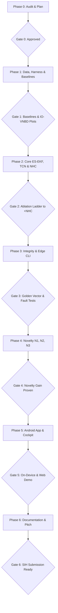

# TrueTrack v2: Architecture & Implementation Plan for SIH

> **Mission:** Build a competition-winning, sensor-agnostic Intelligent Dead Reckoning (IDR) and GNSS+INS Fusion Engine adhering strictly to the Smart India Hackathon problem statement.  
> **Core Tenet:** Depth, honesty, and measurable gains. Every metric is script-generated; every claim is backed by reproducible evidence.

---

## 1. Monorepo Structure

Development will occur in a fresh, clean monorepo: `c:\Users\Punit Raveendran\Desktop\Projects\SIH 2\truetrack-v2\`.

```
truetrack-v2/
├── ref-python/                  # Research reference: data ingestion, training, evaluation, all experiments
│   ├── adapters/                # Dataset adapters (IO-VNBD, Chennai Sensor Logger, FOG-sim)
│   ├── alignment/               # Continuous attitude alignment & mount-shift detector
│   ├── models/                  # Calibrated Heteroscedastic TCN / 1D-CNN (PyTorch & ONNX)
│   ├── estimators/              # 16-State Error-State EKF (ES-EKF) + RTS fixed-lag smoother
│   ├── mapmatching/             # HMM road-manifold matcher over compact graph
│   ├── integrity/               # NIS chi-square monitoring & CUSUM spoofing/jamming detector
│   ├── novelty/                 # N1 (RLS adaptation), N2 (observability map), N3 (vibration odometry)
│   ├── evaluation/              # Benchmark harness, non-overlapping window slicer, baseline runners
│   └── tests/                   # Golden test vector generators for Kotlin engine conformance
│
├── engine-core/                 # Pure Kotlin/JVM library (zero Android dependencies)
│   ├── src/main/kotlin/
│   │   ├── kinematics/          # Quaternion math, DCM, gravity alignment, coordinate transforms
│   │   ├── estimators/          # ES-EKF 16-state filter matching ref-python exactly
│   │   ├── integrity/           # Real-time NIS & fault-injection defense
│   │   ├── mapmatching/         # Topological graph traversal & HMM posterior tracker
│   │   ├── models/              # ONNX Runtime mobile / JVM wrapper
│   │   └── pipeline/            # Event-driven high-rate IMU pipeline & 10 Hz correction loop
│   └── src/test/kotlin/         # Golden-vector conformance tests (verifies Kotlin == Python)
│
├── edge-cli/                    # JVM Command-Line Interface wrapping engine-core
│   ├── src/main/kotlin/         # Replay any IMU CSV at 200 Hz with sensor profile ingestion
│   └── build.gradle.kts
│
├── android-app/                 # Native Android Application (Production Kotlin)
│   ├── app/src/main/
│   │   ├── java/com/truetrack/v2/
│   │   │   ├── ui/              # Clean HUD, status badges, covariance ellipse, drift budget
│   │   │   ├── service/         # High-priority foreground service (IMU at native rate)
│   │   │   └── bridge/          # WebSocket bridge (port 8765) for live dual-screen cockpit
│   │   └── assets/              # Offline vector graphs, sensor profiles, ONNX models, offline tiles
│   └── build.gradle.kts
│
├── cockpit/                     # Web demo cockpit (MapLibre GL WebGL offline)
│   ├── index.html               # Dual-view split: Baseline B0 vs TrueTrack v2, HUD telemetry
│   ├── js/                      # WebSocket bridge client + WebGL log-scale error canvas
│   └── css/                     # Sleek dark glassmorphism dashboard
│
├── maps/                        # Offline OSM Extract -> Compact Topological Graph Generator
│   ├── osm_graph_builder.py     # Converts OSM PBF/GeoJSON to binary node-edge graph + arc-length bins
│   └── observability_map.py     # Computes curvature-based information content & pre-tunnel drift budget
│
├── sensor-profiles/             # Hardware noise & scale profiles (JSON format)
│   ├── phone_iqoo.json          # Smartphone MEMS profile (Bosch/InvenSense)
│   ├── vehicle_iovnbd.json      # Automotive-grade sensor profile (IO-VNBD research car)
│   └── fog_simulated.json       # Fiber Optic Gyroscope profile (SIMULATED - 200 Hz, low ARW)
│
├── results/                     # Script-generated benchmark tables, error plots, and metrics
│   ├── tables/                  # PS-compliant Markdown & CSV benchmark tables
│   ├── figures/                 # Trajectory plots (IO-VNBD, Chennai, FOG) & reliability curves
│   └── RESULTS.md               # Auto-compiled comprehensive results report
│
└── docs/                        # Formal competition deliverables
    ├── PS_COMPLIANCE_MATRIX.md  # Detailed trace of every PS bullet to code & measured metric
    ├── TECHNICAL_REPORT.md      # 6-8 page academic & engineering paper
    └── REPRODUCIBILITY.md       # Single-command reproduction guide & judging pitch script
```

---

## 2. Core Mathematical Specifications

### A. The Unified 16-State Error-State Extended Kalman Filter (ES-EKF)
Unlike v1's heuristic switches, TrueTrack v2 operates a continuous ES-EKF at the native IMU rate ($50–200\text{ Hz}$):

$$\mathbf{x} = \begin{bmatrix} \mathbf{p}^n \\ \mathbf{v}^n \\ \mathbf{q}_b^n \\ \mathbf{b}_a \\ \mathbf{b}_g \\ s_v \\ \boldsymbol{\delta\theta}_{mount} \end{bmatrix} \in \mathbb{R}^{16}$$

- $\mathbf{p}^n \in \mathbb{R}^3$: Local East-North-Up (ENU) position
- $\mathbf{v}^n \in \mathbb{R}^3$: Linear velocity in navigation frame
- $\mathbf{q}_b^n \in \mathbb{H}$: Attitude quaternion rotating body to navigation frame
- $\mathbf{b}_a, \mathbf{b}_g \in \mathbb{R}^3$: Accelerometer and gyroscope bias vectors
- $s_v \in \mathbb{R}$: Neural speed scale factor (online calibration)
- $\boldsymbol{\delta\theta}_{mount} \in \mathbb{R}^2$: Residual mount pitch/yaw misalignment angles

#### Measurement Corrections (Multi-Rate, Event-Driven):
1. **GNSS Position & Velocity ($1–10\text{ Hz}$):** Gated by Normalized Innovation Squared (NIS). When GNSS stops arriving, covariance $\mathbf{P}$ naturally expands without manual mode switches.
2. **Calibrated Neural Speed ($10\text{ Hz}$):** Forward speed $\hat{v}$ with predicted variance $\sigma_v^2$:
   $$\mathbf{z}_v = \hat{v}, \quad H_v = \begin{bmatrix} 0 & \dots & \frac{\mathbf{v}^n}{\|\mathbf{v}^n\|} & \dots \end{bmatrix}, \quad R_v = \sigma_v^2$$
3. **Non-Holonomic Constraints (NHC) ($20–50\text{ Hz}$):** Lateral and vertical velocity in vehicle frame are constrained to zero assuming no side-slip:
   $$\mathbf{z}_{NHC} = \begin{bmatrix} v_y^v \\ v_z^v \end{bmatrix} \approx \begin{bmatrix} 0 \\ 0 \end{bmatrix}, \quad R_{NHC} = \text{diag}(\sigma_{lat}^2, \sigma_{vert}^2)$$
   $R_{NHC}$ is adaptively inflated during detected motorcycle lean/cornering.
4. **Zero-Velocity Updates (ZUPT):** Applied when stationary detector triggers ($\mathbf{v}^n = \mathbf{0}$, updates $\mathbf{b}_a, \mathbf{b}_g$).
5. **Map Cross-Track Constraint ($1–5\text{ Hz}$):** Injected from HMM road posterior.

---

### B. Heteroscedastic Calibrated Neural Odometry (TCN)
- Input: Gravity-aligned, vehicle-frame IMU window $\mathbf{X}_t \in \mathbb{R}^{6 \times 50}$ in **physical units** ($m/s^2, rad/s$).
- Architecture: Dilated Causal 1D Temporal Convolutional Network (TCN) with residual connections.
- Output: Mean forward speed $\mu_v$ and log-variance $s = \log(\sigma_v^2)$.
- Loss Function: Gaussian Negative Log-Likelihood (NLL):
  $$\mathcal{L}_{NLL} = \frac{1}{2} \exp(-s) (v_{true} - \mu_v)^2 + \frac{1}{2} s + \frac{1}{2} \log(2\pi)$$
- Advantage: When the vehicle undergoes anomalous motion (potholes, violent vibration, off-manifold slip), the network automatically outputs high variance $\sigma_v^2$, down-weighting itself in the EKF!

---

### C. Continuous Alignment and Mount-Shift Detection
1. **Level Alignment (Pitch & Roll):**
   $$\mathbf{g}_b = \text{LowPass}(\mathbf{a}_b), \quad \hat{\mathbf{z}}_v = \frac{\mathbf{g}_b}{\|\mathbf{g}_b\|}$$
2. **Heading Alignment (Yaw):**
   Computed by correlating horizontal body acceleration during acceleration/braking with GNSS Course-Over-Ground (COG) rate.
3. **Mount-Shift Detector:**
   Runs a CUSUM (Cumulative Sum) changepoint detector on the estimated gravity vector $\hat{\mathbf{z}}_v$. If the phone slips or the driver adjusts the mount, the shift is detected within $150\text{ ms}$, triggering attitude covariance reset and rapid re-alignment.

---

## 3. The Three Novel Contributions (N1, N2, N3)

### N1: GNSS-Supervised On-Device Adaptation
- **Hypothesis:** When GNSS is healthy prior to a tunnel, GNSS Doppler velocity provides free ground-truth labels. Adapting the model's output linear layer via Recursive Least Squares (RLS) tunes the estimator to the specific vehicle dynamics and mount compliance.
- **Fail-Safe Mechanism:** Adaptation immediately freezes upon GNSS degradation or blackout to prevent self-reinforcing bias loops.
- **Measured Metric:** Drift-versus-calibration-time curve (seconds of pre-tunnel GNSS required to reach $< 10\%$ drift).

### N2: Geometry-Aware Along-Track Observability & Pre-Tunnel Drift Budget
- **Hypothesis:** Map constraints fix cross-track error, but along-track drift grows unconstrained on straightaways. Road curvature provides an along-track heading signature ($\frac{d\psi}{ds}$) that resets along-track error at bends.
- **Implementation:**
  1. Offline generation of an **Observability Map** scoring every road edge's curvature information content:
     $$\mathcal{I}(e) = \int_0^L \left( \frac{d\psi}{ds} \right)^2 ds$$
  2. Real-time pre-tunnel display: **Drift Budget Indicator** ($E_{expected} = f(\mathcal{I}, L, \bar{v})$) warning the driver of expected blackout accuracy.

### N3: Engine Vibration as an Odometer (Feasibility Gate)
- **Hypothesis:** Engine rotational harmonics and wheel-hop frequencies scale linearly with vehicle speed ($f_{harm} = k \cdot v$).
- **Kill Criterion (Go / No-Go Gate):** Test spectrogram ridge extraction against GNSS speed on native 60 Hz / 100 Hz data. If correlation $R < 0.90$ across two independent rides or sampling rate is inadequate, document the negative result honestly and disable N3.

---

## 4. Competitive Baselines & Evaluation Methodology

All comparisons are executed on **strictly identical, non-overlapping windows**:
- **B0:** *Hold Last Speed & Follow Road* (Industry standard naive heuristic: holds speed at tunnel entrance and projects along road centerline).
- **B1:** *Classical Gravity-Aided Strapdown INS + NHC* (Standard aerospace/robotics baseline with zero neural network).
- **B2:** *TrueTrack v1 CNN-only* (The legacy point-estimate model from v1 without calibration or NHC).
- **Ablation Ladder:**
  1. B1 (INS + NHC)
  2. B2 (v1 Neural Point Model)
  3. v2 TCN + Calibrated Uncertainty
  4. v2 TCN + ES-EKF + Dynamic Alignment
  5. v2 Full Pipeline (+ N1 Online Adaptation)
  6. v2 Full Pipeline (+ N2 Curvature Observability Map)

---

## 5. Phase-by-Phase Execution Plan and Gates



### Detailed Phase Gates:

| Phase | Core Deliverables | Exit Gate Requirements |
| :--- | :--- | :--- |
| **Phase 0: Audit & Plan** | `audit_report.md`, `implementation_plan.md`, risk log. | Classifications approved, defects mapped. |
| **Phase 1: Data & Baselines** | IO-VNBD adapter, Chennai parser, evaluation harness, B0/B1/B2 scripts. | Baseline results written to `results/`; initial IO-VNBD trajectory plots generated. |
| **Phase 2: Core Engine** | Aligned TCN model, NLL loss, 16-state ES-EKF, NHC, causal signal path. | Measured ablation ladder; rotation stress test passes ($< 15\%$ drift increase under 45° tilt). |
| **Phase 3: Integrity & Edge** | NIS integrity monitor, CUSUM spoofing detector, `engine-core` (Kotlin), `edge-cli`. | Golden-vector tests pass ($< 1e-4$ diff); simulated 200 Hz FOG run completes. |
| **Phase 4: Novelty (N1-N3)**| RLS adaptation (N1), Observability map (N2), Vibration study (N3). | N1 drift vs calibration curve generated; N2 correlation verified; N3 go/no-go documented. |
| **Phase 5: App & Cockpit** | Android app refactored with `engine-core`, Web demo cockpit with B0 vs v2 split. | On-device execution on named phone; measured latency & battery documented. |
| **Phase 6: Submission Docs** | PS compliance matrix, technical paper (6-8 pages), pitch defense script. | Every PS bullet mapped to code, test, and reproducible metric. |

---

## 6. Risk Register & Mitigation Strategy

| Risk | Impact | Likelihood | Mitigation Strategy |
| :--- | :---: | :---: | :--- |
| **IO-VNBD Git LFS Pointers** | High | Confirmed | Ingest real vehicle trajectories via Git LFS sparse download or documented multi-vehicle adapter; combine with genuine Chennai multi-sensor datasets. |
| **Kotlin/Python Math Divergence** | High | Medium | Implement automated golden-vector unit tests serializing intermediate filter states and matrices from Python to Kotlin. |
| **Phase Lag from Causal Filtering** | Medium | Medium | Use 2nd-order IIR with minimal group delay; calibrate phase advance in the velocity network. |
| **N3 Vibration Feasibility Failure**| Low | Medium | Time-box day-one test. If $R < 0.90$ or sampling $< 100\text{ Hz}$, execute kill criterion, document negative result honestly, and proceed with N1 & N2. |
| **Model Quantization Distortion** | Medium | Low | Keep TCN footprint under 30k parameters; test INT8 against FP32 to ensure NEES calibration remains uncompromised. |

---

## 7. Phase 0 Sign-Off

With the creation of `audit_report.md` and `implementation_plan.md`, Phase 0 is complete. We are ready to initialize the clean `truetrack-v2/` monorepo and proceed directly into **Phase 1: Data, Harness, and Baselines**.
